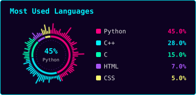
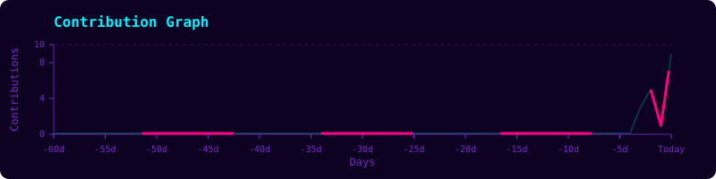

<!-- 上部のネオンフレーム -->

<!-- メイン看板（上下2行が同期して再描画されるターミナル演出） -->

  
<!-- SNS・外部リンクボタン -->

&nbsp;

&nbsp;

 
<!-- セクション区切りのネオンフレーム（パープル） -->

 

<!-- セクション1：SYSTEM INFO -->

 

> 👤 **Name:** 沙渡 椿 (Tsubaki Sawatari) 🔗 **ID:** `@Swingray350` 🛠️ **Class:** Hardware Hacker & Maker

 

> _"Building physical & digital things in neon light."_  

 

 

<!-- セクション2：CORE STACK -->

 

 

  

 

  

 

  

 

  

 

<!-- セクション3：TELEMETRY DATA -->

  
<!-- カスタム生成されたECG波形グラフ -->

 

 

<!-- セクション4：HARDWARE LAB -->

 

>    

 

> 🖊️ **Motorized Pen Holder** (XIAO ESP32C6) 💡 **Neon Sign** (Filament LEDs & I2S Audio) 📡 **Smart Desk Light** (mmWave Presence Sensor)

 

  

<!-- 下部のネオンフレーム（パープル） -->

