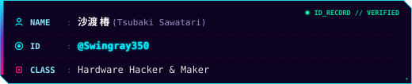
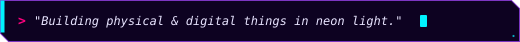
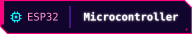
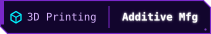
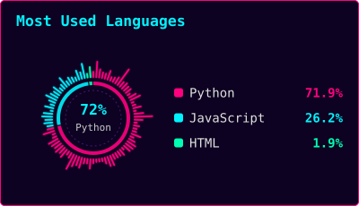
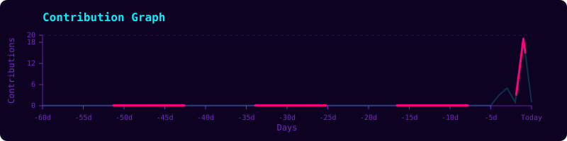
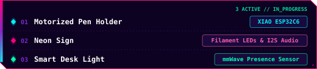

<!-- 上部のネオンフレーム -->

<!-- メイン看板（上下2行が同期して再描画されるターミナル演出） -->

  
<!-- SNS・外部リンクボタン -->

&nbsp;

&nbsp;

 
<!-- セクション区切りのネオンフレーム（パープル） -->

 

<!-- セクション1：SYSTEM INFO -->

 

 

 

 

 
 

 

 

<!-- セクション2：CORE STACK -->

 

 

  

 

  

 

  

 

  

 

<!-- セクション3：TELEMETRY DATA -->

  
<!-- カスタム生成されたECG波形グラフ -->

 

 

<!-- セクション4：HARDWARE LAB -->

 

 
 
 
 

 

 

 

  

<!-- 下部のネオンフレーム -->

